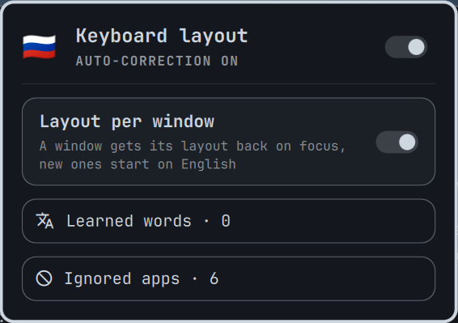

# layoutless

Automatic keyboard layout correction for [Omarchy](https://omarchy.org/) / Hyprland, in the spirit of Punto Switcher.

Type without thinking about the layout. When a word comes out in the wrong one (`ghbdtn` → `привет`, `руддщ` → `hello`), layoutless retypes it in the right layout and switches the layout for you.


> Status: 0.1, early. Works day to day on the author's machine; expect rough edges.

## Features

- **Auto-correct the last word.** When you finish a word with Space or Shift+Enter, layoutless checks whether it reads better in the other layout. If it does, it erases the word, retypes it, and leaves the corrected layout active so you can keep typing.
- **Force flip with `Alt+Space`.** If layoutless guessed wrong or missed a word, press `Alt+Space` to flip the last word. Right after an auto-correction, `Alt+Space` undoes it instead.
- **Learns your words.** If you flip the same word by hand twice, layoutless remembers which layout it belongs to. For example, `next` typed in the Russian layout comes out as `туче`, which is a valid Russian word, so a dictionary alone would never flip it. After two manual flips it always does. Undoing an auto-correction twice teaches it to leave that word alone.
- **Works everywhere you type.** It works in browsers, terminals, Electron and JetBrains apps, because it uses only Backspace and replays the same physical keys after switching the layout.
- **Layout per window** (`per_window = true`). Each window gets its layout back when it's focused again; new windows start on the first layout. The Omarchy menu always opens in the first layout. The same daemon switches the layout for corrections and for focus changes, so the two never race.
- **Omarchy bar widget.** The flag of the current layout (dimmed only while the daemon is not running); a click switches the layout. Its panel has the flag and the state in the header, then toggles for auto-correction and the layout per window (a feature each, so not in the header); two buttons with counts open the learned words (find, add, forget) and the ignored apps (with a toggle for the current app) in windows in the middle of the screen. The interface follows the system language (English, Russian).

Supported layouts: `us` + `ru` for now. The design keeps layout pairs pluggable.

## How it works

```
physical keyboard ──evdev (read-only)──▶ layoutless daemon ──uinput──▶ Backspace × N, replay keys
                                            │  ▲
                Hyprland IPC (socket2) ─────┘  └── `layoutless flip` (Alt+Space bind)
                activelayout / activewindow       `layoutless subscribe` (bar widget)
```

1. The daemon passively reads key events from your physical keyboards and keeps the physical keys of the word being typed. It never grabs the keyboard, so typing is never delayed.
2. On a word boundary it scores the word under both layouts. It checks your learned rules first, then dictionaries, then a letter n-gram model.
3. To correct a word it sends Backspace once per key, switches the layout with `hyprctl switchxkblayout`, and replays the same physical keys. Because the keys are the same, no character mapping is needed on output.
4. All keyboards share one layout. Hyprland switches a layout (Alt+Alt) only on the keyboard it was typed on, so when an external keyboard switches, the daemon brings every keyboard to that layout, and the bar flag follows it.

## Privacy and permissions

layoutless has to see what you type, so its rules are strict:

- It keeps only the current and previous word, in memory only. It never logs or sends keystrokes anywhere. The exception is `LAYOUTLESS_DEBUG=1`, a debugging mode that prints every key to stderr: never leave it on.
- Learned rules (`~/.local/share/layoutless/rules.json`) store only words you flipped by hand. The file is plain JSON, so you can read and edit it.
- Reading keyboards requires membership in the `input` group, and typing requires write access to `/dev/uinput`. Any program running as your user with these permissions can read every keystroke. That's the cost of a global layout corrector on Wayland.
- Corrections are off on the lock screen, in excluded apps (password managers by default) and while the polkit password prompt is open. Words with digits, `-` or `=` are never auto-corrected, which covers most passwords. Password fields elsewhere are not detected: a letters-only password typed in the wrong layout may get corrected, so the login fails and you retype it. Nothing leaks, because nothing is logged.

## Install

layoutless has two parts: the daemon (does the work) and the Omarchy bar widget (optional UI).

### Dependencies

- Hyprland (the daemon talks to its IPC sockets). Omarchy is needed only for the bar widget.
- A notification daemon for the "word learned" notification (Omarchy has one), and
  `util-linux` (`setpriv`) for the widget.
- Access to keyboards and `/dev/uinput`: your user in the `input` group, a udev rule and the
  `uinput` module. `install.sh` sets these up.
- To build: Rust (`omarchy pkg add rustup && rustup default stable`).

### Daemon

```bash
git clone https://github.com/kladaFOX/layoutless
cd layoutless
./install.sh
```

It builds the daemon and installs it for your user (`~/.local/bin/layoutless` and a systemd
user service). Before using `sudo` it shows what it will do and asks: a udev rule for
`/dev/uinput`, loading the `uinput` module, and adding you to the `input` group. Log out and
back in once after the first install; the daemon starts by itself afterwards. Run it again
after `git pull` to update.

#### Without the `input` group

```bash
./install.sh --system
```

The `input` group gives every program running as you access to all keyboards. With `--system`
the daemon runs as a system service `layoutless@$USER`: as your user, but with the `input` group
for itself only (`SupplementaryGroups=input`), so your other programs can't read the keyboard or
type through `/dev/uinput`. No log out is needed. The binary goes to `/usr/local/bin/layoutless`,
owned by root, so a program running as you can't replace what runs with the group; updating
after `git pull` therefore needs sudo again (`./install.sh --system`). The service waits for your
Hyprland and attaches to its newest instance. The separation relies on
`kernel.yama.ptrace_scope` being 1 or higher (the Arch default), so programs running as you
can't attach to the daemon. A previous user-service install is removed. `./install.sh --uninstall`
removes either kind.

An AUR package is prepared in `packaging/aur/` and will be published once AUR registration
reopens.

The daemon binds the flip key (`Alt+Space` by default, `flip_key` in the config) in Hyprland
itself and re-binds it after every Hyprland config reload; nothing is written to your Hyprland
config. Don't also bind `layoutless flip` yourself: the flip would run twice and undo itself.

### Bar widget

```bash
omarchy plugin add https://github.com/kladaFOX/layoutless --enable
```



The widget shows the flag of the current layout (a keyboard icon while the daemon isn't
running) and replaces a separate layout widget. Left click switches the layout. Right click
opens the panel: the flag and the state in the header, then the auto-correction and the
layout per window toggles (↑/↓ walk the rows, Enter toggles or opens). The two
buttons below show how many learned words and ignored apps there are and open each list in a
window in the middle of the screen: the learned words with the field that finds and adds them,
the ignored apps with the toggle for the current app. Paused auto-correction leaves the flag
as it is. The text
follows the system language (`LC_ALL`, `LC_MESSAGES`, `LANG`): English or Russian (`I18n.js`,
checked by `node test.js`). `qs ipc -p $OMARCHY_PATH/shell call kladafox.layoutless-lists
words|apps|close` opens and closes the lists.

## Uninstall

```bash
omarchy plugin remove kladafox.layoutless   # the bar widget
./install.sh --uninstall                    # the daemon, service, udev rule and module config
```

Your settings (`~/.config/layoutless`) and learned words (`~/.local/share/layoutless`) are
kept; delete them by hand if you don't want them. Leave the `input` group with
`sudo gpasswd -d "$USER" input` if nothing else needs it. The flip key stays bound to a command
that only prints "daemon not running" until the next Hyprland config reload or login.

## Configuration

`~/.config/layoutless/config.toml` (optional; `layoutless reload` re-reads it):

```toml
auto = true                      # auto-correction on start
notify = true                    # desktop notification when a word is learned
learn_threshold = 2              # manual flips of the same word that make it a rule
flip_key = "ALT + SPACE"         # Hyprland syntax; the daemon binds it in Hyprland itself
exclude_apps = [                 # window classes, as in `hyprctl activewindow`
  "org.keepassxc.KeePassXC", "1Password", "Bitwarden",
  "gcr-prompter", "pinentry-qt", "pinentry-gtk",
]
exclude_layers = ["omarchy-polkit"]  # shell popups, e.g. the polkit password prompt
per_window = false               # keep the layout per window
first_layout_only = ["omarchy-menu"] # with per_window: classes and popups always in the first layout
```

Commands: `layoutless auto on|off|toggle`, `layoutless status`, `layoutless flip`,
`layoutless rules [list | add WORD | rm WORD]`, `layoutless exclude add|rm CLASS`,
`layoutless per-window on|off|toggle` (saved to `per_window` in the config).

Learned words live in `~/.local/share/layoutless/rules.json`. `rules add next` makes
`next` always come out as `next` (typing `туче` turns into it); `rules add привет` does the
opposite for a Russian word.


## Colours

Status colours (red, orange) are fixed rather than the theme's, whose red or
yellow can be any colour: `FixedColors.qml` reads them from
`~/.config/omarchy/predmaxim/palette.json` (`{"red": "#e5534b", ...}`) and
falls back to the theme's alert colour without that file.

## License

MIT for the code. The bundled word lists in `daemon/data/` are derived from
[hermitdave/FrequencyWords](https://github.com/hermitdave/FrequencyWords) (OpenSubtitles 2018)
and are licensed under [CC BY-SA 4.0](https://creativecommons.org/licenses/by-sa/4.0/);
see [daemon/data/README.md](daemon/data/README.md).
